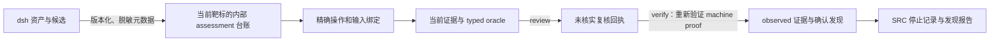

# 红队、内置证据评估与 SRC 模式

本次本地升级为 dsh-purge **1.8.0**。awa-ddd **2.2.0** 的生产评估源码已写入 `lib/redteam/assessment-engine/`，随 dsh-purge 的源码和发行包提供。红队编排管理资产与任务，内置核心在当前靶标的台账中验证具体假设；SRC 在取得直接证据后停止该项测试。独立 awa-ddd 项目的 2.2.0 升级继续保留，dsh-purge 运行时直接使用自己的随包核心。



## 模式和边界

| 项目 | 红队 | SRC |
| --- | --- | --- |
| 创建模式 | `assessment_mode:redteam`，默认 | `assessment_mode:src` |
| 范围 | 操作者声明的既有范围 | 创建时固定非空 scope，明确 exclude（可为空） |
| 工具 | 原红队数据与编排工具，加内置评估工具 | 发现、证据、报告与内置评估工具 |
| 目标执行 | 既有工具与评估契约 | 内置核心的有界只读 HTTP、浏览器观察；目标写入与主动外部适配器被拒绝 |
| 确认 | 可使用内置核心的当前机器证明复核 | 当前靶标内完整、核实的 observed 直接证据 |
| 停止 | 由当前评估任务决定 | 直接证据确认后持久停止该项，其他明确未确认操作可继续 |
| 报告 | 演练报告与评估覆盖报告 | SRC 发现报告，保留未测和待核实分母 |

SRC 会话绑定及父子关系写入本地台账。冷父会话、切换 preset 或旧子会话记录不能遮蔽 SRC。宿主使用 `tools.guard()`；旧接口沿 `tools/execute` 在派发前拒绝非允许工具。普通审批返回允许不覆盖该边界。SRC 下不注入普通 Purge boost，独立 SRC 指引保留。

模式在创建时固定。既有红队靶标或内部评估上下文不能通过普通 open/update 转成 SRC；新建对应模式的任务保留各自证据历史。SRC 会话不提供通用 shell、PowerShell、外部 MCP、独立 AWA 工具或委派入口；实际评估使用当前靶标的内置核心。

## 随包核心与靶标台账

`lib/redteam/assessment-engine/` 包含 Python 评估核心、动作契约、受限进程调度和 AST 辅助代码。原 MIT 许可证、版权与来源说明分别保存在该目录的 [LICENSE](../lib/redteam/assessment-engine/LICENSE)、[NOTICE.md](../lib/redteam/assessment-engine/NOTICE.md) 和 [provenance.json](../lib/redteam/assessment-engine/provenance.json)。来源清单记录上游与随包文件的 SHA256 及适配说明，供离线核对；没有复制独立插件入口、宿主 SDK、安装器、测试或用户数据。

每个 engagement 独立使用 `<当前靶标目录>/assessment` 工作区，内部 `project_id` 固定为 `assessment`。代码路径从 dsh-purge 自身的安装位置确定，工作区从当前靶标确定。模型只能提交评估动作和业务参数，不能指定引擎代码路径、外部 workspace、后端或 project_id。

演练台的「内置评估」页检查当前上下文，并在需要时提供目标 URL、明确 URL 范围与 v1/v2 评估模型选择。靶标 scope 已含真实 HTTP(S) URL，或当前靶标的候选、HTTP 证据或资产中已有经范围核实的实际 URL 时，首次评估操作可以直接初始化内部上下文；只有域名、IP 或 CIDR 且没有实际 URL 时，需要补充属于该靶标范围的真实 HTTP(S) 目标与 URL 范围。初始化继承 SRC 模式与来源排除项，不能扩大范围或略过排除子路径，无需选择或绑定外部项目。评估模型在上下文首次创建时固定。

内置评估要求 Node.js 22.19+、Python 3.10+；实际浏览器观察仍需要现有 Playwright 运行时。状态检查、初始化、候选导入、已有证据复核和报告生成只处理本地材料。`assessment_run` 是否访问目标取决于所选动作及其契约。

升级保留旧 `settings.json` 中的外部 AWA 路径/工作区字段及靶标的 `awa-binding.json`，这些旧 settings/binding 不选择或执行外部代码，也不成为新版内部上下文。原提示词、用户设置和独立 AWA 数据不被覆盖；升级源码不自动安装、应用补丁或重启正在运行的 DSH。

## 使用流程

在模式下拉选择 **SRC 漏洞发现模式**，或在演练台「新建靶标」中选择 SRC，填入明确范围。工具入口如下；示例地址仅是格式示例，应替换为实际已授权范围。

```json
{"target":"示例单位 SRC","assessment_mode":"src","scope":["https://authorized.example/app"],"exclude":["https://authorized.example/app/logout"]}
```

上面的参数交给 `redteam_engagement_open`。既有 SRC 靶标用 `redteam_session_bind` 传精确 ID 或名称，不用模糊匹配。

1. `redteam_assessment_status` 检查随包核心与当前靶标的内部上下文。
2. `redteam_assessment_start` 在需要时用真实 target、URL scope 初始化当前靶标，首次可选 `assessmentModel:v1/v2`。
3. `redteam_assessment_import` 导入来源候选页，保留返回的 `import_id/candidate_id/next_offset`；导入分页与复核分页独立。
4. `redteam_assessment_run` 调用内置 typed action，明确操作、输入、身份及控制证据。
5. `redteam_assessment_review verify:false` 接收未核实回执；`verify:true` 重新核验当前机器证明并确认符合条件的发现。
6. `redteam_src_report` 生成 SRC 发现报告。界面也提供「报告」页。

准备当前靶标的内部评估：

```json
{"target":"https://authorized.example/app","scope":["https://authorized.example/app"],"assessmentModel":"v1"}
```

上面的参数交给 `redteam_assessment_start`。有明确 URL scope 或已登记实际 URL 的靶标可省略重复的 target/scope，初始化从靶标策略和范围内已知 URL 取值；目标无法明确时保留待初始化状态，不从名称、IP 或外部工程猜测协议和路径。初始化用的 URL 范围不代替真实请求输入，不能从脱敏 locator 重建查询值。已有上下文直接复用。

候选导入：

```json
{"offset":0,"limit":50}
```

上面的参数交给 `redteam_assessment_import`。候选格式保留 `dsh-purge-awa/v1` 以兼容已有记录，导入发生在同靶标的内部台账。导入单页最多 200 个候选与 200 条 HTTP 元数据，默认 50 个候选；返回的 `page_kind:source_candidates` 与 `next_offset` 指向来源页。中文靶标使用稳定的不透明 ASCII 来源 ID。未明确 HTTP URL、含已知凭据或超出来源范围的候选保留 `skipped` 原因。HTTP `sha256` 的 `hash_scope:metadata` 表示元数据摘要，原始请求/响应和凭据不进入候选导入。

导入 URL 和标题内 URL 省略所有查询值，`query_omitted:true` 保留输入待绑定提示；摘要仅覆盖公开元数据。实际请求从私有证据显式绑定，不用脱敏 locator 拼请求。内置 Node 调度的单次 JSON 请求上限为 1 MiB，Python 协议为 2 MiB；较长候选使用小页，默认 50 条。

调用具体评估动作：

```json
{"action":"candidate.inspect","input":{"candidate_id":"实际返回的 C-ID"}}
```

```json
{"action":"candidate.link","input":{"candidate_id":"实际 C-ID","operation_id":"实际 O-ID","input_location":"query","input_selector":"keyword"}}
```

```json
{"action":"assessment.prepare","input":{"operation_id":"实际 O-ID","limit":3}}
```

上述参数交给 `redteam_assessment_run`，内部 project 与工作区由当前靶标提供。陌生动作先 `action.help input:{name:"动作名"}`，按返回契约操作，不猜 ID 或证明字段。输入类候选必须精确绑定 selector；同 endpoint 的其他参数、其他漏洞族和人工文字不能代替本项证明。

### v2 的任务与快照

首次以 v2 准备评估时，内置核心实际创建 Python Campaign 和冻结的 Universe。该快照记录当时已登记的资产和输入；只有 URL 范围、还没有具体操作时，初始快照可能没有可执行配方。后续 `surface.register` 或导入补充了实际 inventory 后，需要显式建立当前快照：

```json
{"action":"campaign.start","input":{"model":"v2","new_campaign":true}}
```

上面的参数交给 `redteam_assessment_run`。使用本次返回的 `campaign_id` 调用 `campaign.next`，再以实际返回的 `recipe_id` 和该 campaign_id 调用 `test.run`。新任务仍使用同靶标的固定内部项目与范围；原快照和历史证据保留。`checkpoint` 只记录当前任务的快照与进度，不会自动把新资产或输入扩入 Universe，不能把旧的空快照当作后续范围覆盖。

公开 `campaign.start` 成功后会更新内部 current campaign ID。Python 已完成 v2 初始化而本地上下文未落盘时，恢复从同靶标数据库的不可变启动审计事件中选择最后一次持久启动且仍 active 的 campaign；多个 active 任务按该顺序选择。无 active 任务时，只恢复最近启动的终态历史以供离线报告。恢复不额外 start、不改变 Python 数据或丢弃历史，明确指定 v1 不能把既有 v2 上下文降级。

复核本靶标全部已纳入候选：

```json
{"verify":true,"offset":0,"limit":50}
```

上面的参数交给 `redteam_assessment_review`。`verify:false` 仅保存未核实回执，`verify:true` 重新检查本项当前机器证明。原生复核按同靶标全部已纳入候选统一分页，无需指定 import_id；单页上限 100，默认 50。返回的 `page_kind:assessment_candidates` 与 `next_offset` 指向评估候选页。

面板分别记录「来源候选页偏移」和「评估复核页偏移」。导入来源第 2 页（offset 50）后，首次复核仍从评估 offset 0 开始；结果中的下一页按钮只更新对应游标。继续纳入来源候选不会改变复核游标，切换靶标时两者归零。工具调用也应分别保留这两种游标。

旧 AWA JavaScript API 与 HTTP `awaStatus/awaProject/awaSync/awaCall` 操作作为兼容入口使用同一内置核心；模型评估工具注册的是上述五个 `redteam_assessment_*` 入口，不再注册旧 `redteam_awa_*` 工具。外部项目绑定流程不再用于新版运行。

## 确认与停止

`assessment_review verify:false` 将回执保存到兼容的 `awa_review` 与 `inferred` 证据账本，保留来源、当前状态和限制。`verify:true` 再次执行内置核心的离线导出：只有当前、validated、machine、可用于确认的 decision，完整证据哈希与精确族/输入绑定，以及对应当前机器 finding（v1 为 confirmed、v2 为 machine_confirmed）同时成立，才由可信代码调用 `EvidenceLedger.upgrade` 生成 observed 直接证据并确认来源发现。重复 verify 不产生重复证据；失效、缺字段、analyst 或来源 confirmed 标签保持 `confirmation_pending`。

确认的标题和严重级采用实际评估 finding，原扫描器标题、等级和 CVE 保留为独立 `source_claim`。源 CVE 声明不成为机器证明中的 CVE 归因，也不把有限 SQL/访问控制证明扩大为远程代码执行或更高权限。

模型可以整理 HTTP、浏览器、协议或源码位置材料，并登记 claimed/inferred 候选。模型文本声明、自己填写的 `direct_evidence/verified_result` 或哈希一致都不能构成核实；SRC 模型不能自由声明 observed、伪装工具输出权威或用自由填写的 evidence_upgrade 参数确认。

SRC confirmed 必须来自 `assessmentReview verify:true` 对真实机器证明的重新验证，或可信操作员/代码路径对实际材料与观察的核实；之后才使用本靶标的 observed `ev_id`、完整哈希、相同具体目标、有支持的 `proof_type` 和实际直接观察。原生复核保持完整证据、当前 finding 和精确输入关联的要求。扫描器命中先登记候选，标题、口头回报和模型自行拼出的证明字段不代替可信核实。

SRC 确认保存 `stop_reason:direct_evidence_obtained`。内置核心阻止同操作/endpoint/路径模板的后续请求；dsh 来源账本已有直接证据时，调度层同样阻止再访问该目标。离线帮助、证据、复核和报告继续可用。已存在停止记录时，未能解析具体目标的主动动作会要求明确未停止操作的输入关联。

SRC 发现报告只描述已证实的问题及未完成项，公开报告省略 URL 查询值。它不提供整个攻击面的耗尽证明；内置核心原有 finalization 与覆盖门禁保留。SRC 没有写入前提的业务写侧问题应保留待核实，而非绕过模式。

## 离线源码维护

维护者使用 [scripts/sync-assessment-engine.mjs](../scripts/sync-assessment-engine.mjs) 核对随包来源，或把明确选择、已审阅的本地 awa-ddd 生产源码同步写入本项目：

```sh
node scripts/sync-assessment-engine.mjs --check
node scripts/sync-assessment-engine.mjs --source "../awa-ddd"
```

`--check` 只读取本项目的来源清单和源码，无需同级 awa-ddd，也不访问网络。`--source` 是维护时的离线源码导入，更新 MIT/来源清单与受管文件；普通运行和升级不自动同步外部源码。独立 awa-ddd 项目及其 2.2.0 升级不因该步骤而改写。

## 验证与实际限制

`npm run test:redteam` 检查会话/父子关系、原生 SDK 派发门禁、范围、回执归属、哈希、停止与报告。`node --test test/redteam-native-assessment.test.mjs` 从隔离安装的 `lib` 目录验证内置初始化、真实评估契约、直接证据确认与报告，不依赖同级 awa-ddd。面板异步状态与原生请求参数由 `node --test packages/purge-panel/test/awa-evidence.test.mjs` 验证。测试输出中的失败和 skipped 必须分别报告，不能把跳过计为通过。

测试使用独立临时数据库、合成业务响应与本地传输 mock，不对客户系统发请求。真实 DSH GUI、实际目标和完整桌面部署需分别验收。

SRC 的方法、effect、预算和停止门禁不能判断任意服务器 GET 的实际副作用、目标内部 SSRF 出站或手工 HTTP 输入的所有业务语义。直接证据应选择实际低影响控制；未知影响保留待核实。传统红队凭据库的静态存储加密属于独立迁移问题；候选导入与 SRC 报告不会导出凭据字段。
