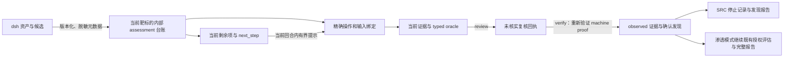

# 红队、SRC 与内置 awa-ddd 渗透模式

本次本地升级为 dsh-purge **1.11.0**。awa-ddd **2.2.0** 的生产评估源码随本包提供，本地适配单独记录来源与哈希。红队管理演练目标、资产与任务，SRC 按漏洞提交流程记录具体安全缺陷并在直接证据到位后停止；渗透完成受控 Web/API 评估、证据复核、独立加固建议和完整报告。独立 awa-ddd 项目不由本轮改写或选择执行。

本轮按 Pojun 对照分析补齐证据差分、sourcemap 离线分析、批量 typed capture、本地材料和情报、技能目录与当前证明驱动建议，新增源码独立编写，并做本地隔离回归。1.10.0 的四预设 Loader/空白工具目录结果保留原记录，本轮未新增正式 GUI、86 条补丁、实际调度、浏览器或真实目标验收，没有发布、安装、apply、退出或重启正式 DSH。[升级方案](MODE-UPGRADE-1.11.0-PLAN.md) · [实施与验证](MODE-UPGRADE-1.11.0.md) · [动作指南](DISCOVERY-WORKFLOW.md) · [SRC 提交流程](SRC-SUBMISSION.md) · [渗透模式步骤](PENTEST.md)。历史记录保留各自验证口径。



## 模式和边界

| 项目 | 红队 | SRC | 渗透模式 |
| --- | --- | --- | --- |
| 创建模式 | `assessment_mode:redteam`，默认 | `assessment_mode:src` | `assessment_mode:pentest` |
| 范围 | 操作者声明的既有范围 | 创建时固定非空 scope，明确 exclude（可为空） | 同样固定非空 scope、明确 exclude 与会话绑定 |
| 工具 | 显式数据/编排清单和内置评估；有范围时拒绝无法证明目标的通用执行体 | 发现、证据、报告与内置评估工具 | 当前会话内置测试、证据与完整报告，不提供通用 shell、文件或委派入口 |
| 目标执行 | 声明 scope/exclude 时持久绑定并通过 typed 评估检查范围 | 有界只读 HTTP/浏览器观察；写入与主动外部适配器拒绝 | 随包核心的普通 assessment 策略，写测试按既有身份/自有资源/fixture/变更契约 |
| 收录 | 当前演练发现与成果，配置建议独立解释 | 具体安全缺陷；纯缺头、banner 和配置建议不入漏洞台账 | vulnerability 与 hardening/informational 建议独立计数 |
| 确认 | 可使用内置核心当前机器证明 | 本靶标完整、核实的 observed 直接证据 | 同靶标当前机器复核；来源文字保持 claimed/inferred，machine/reviewed 质量分列 |
| 停止 | 由当前评估任务决定 | 直接证据确认后持久停止该项 | 不采用 SRC 单项停测；按授权、实际前提、取消与当前覆盖决定 |
| 报告 | 合并交付及私有得分复现 | SRC 发现和覆盖/停止报告 | `redteam_pentest_report` 完整渗透报告及原生复现/矩阵附件 |

SRC、渗透及有 scope/exclude 的红队会话绑定和父子关系写入本地台账。冷父会话、切换 preset 或旧子会话记录不能遮蔽固定模式。宿主使用 `tools.guard()`；旧接口沿 `tools/execute` 在派发前拒绝非允许工具。普通审批返回允许不覆盖该边界。SRC/渗透都不注入普通 Purge boost，分别保留当前模式指引。空范围历史红队保持兼容，不宣称存在目标围栏。

模式在创建时固定。已有 SRC/红队/渗透靶标不能通过普通 open/update 或切换 preset 变为另一模式；新建对应任务保留各自历史。SRC/渗透模式都不提供通用 shell、PowerShell、外部 MCP、独立 AWA 或委派入口；实际评估使用当前靶标内置核心。未绑定会话不回退其他会话的全局 current。

SRC 的 `plan/recon/assess/vuln-scan` 是当前会话的阶段角色稿，使用 `redteam_role_prompt` 获取和依次使用，不代表四个子代理或委派权限。随包 `src-discovery` 同步到 `$DSH_HOME/redteam/src-skills`，SRC 的原生技能根只使用这个包内同步目录；红队技能根也获得同份技能。旧预设的技能行在注册时只做内存补充，用户 YAML 原文保留。`redteam_src_runbook resource:skill/workflow` 可直接读取当前安装的固定技能或完整文档，原生技能工具缺失时仍可加载，不接受任意资源路径。

## 随包核心与靶标台账

`lib/redteam/assessment-engine/` 包含 Python 评估核心、动作契约、受限进程调度和 AST 辅助代码。原 MIT 许可证、版权与来源说明分别保存在该目录的 [LICENSE](../lib/redteam/assessment-engine/LICENSE)、[NOTICE.md](../lib/redteam/assessment-engine/NOTICE.md) 和 [provenance.json](../lib/redteam/assessment-engine/provenance.json)。来源清单记录上游与随包文件的 SHA256 及适配说明，供离线核对；没有复制独立插件入口、宿主 SDK、安装器、测试或用户数据。

每个 engagement 独立使用 `<当前靶标目录>/assessment` 工作区，内部 `project_id` 固定为 `assessment`。代码路径从 dsh-purge 自身的安装位置确定，工作区从当前靶标确定。模型只能提交评估动作和业务参数，不能指定引擎代码路径、外部 workspace、后端或 project_id。

演练台的「内置评估」页检查当前上下文，并在需要时提供目标 URL、明确 URL 范围与 v1/v2 评估模型选择。靶标 scope 已含真实 HTTP(S) URL，或当前靶标的候选、HTTP 证据或资产中已有经范围核实的实际 URL 时，首次评估操作可以直接初始化内部上下文；只有域名、IP 或 CIDR 且没有实际 URL 时，需要补充属于该靶标范围的真实 HTTP(S) 目标与 URL 范围。初始化继承 SRC 模式与来源排除项，不能扩大范围或略过排除子路径，无需选择或绑定外部项目。评估模型在上下文首次创建时固定。

内置评估要求 Node.js 22.19+、Python 3.10+；实际浏览器观察仍需要现有 Playwright 运行时。桌面版会优先复用随应用提供的 Python，也可用 `PURGE_PYTHON` / `AWA_DDD_PYTHON` 或已有评估设置显式指定。状态检查、初始化、候选导入、已有证据复核和报告生成只处理本地材料。`assessment_run` 是否访问目标取决于所选动作及其契约。

### 运行环境面板与预检

「内置评估」显示解释器位置与版本、Node 要求、Playwright 模块/缓存定位、SRC 注册回执的来源和时间、技能同步及续跑钩子登记状态。定位文件不等于解释器可启动，模块或缓存不等于 Chromium 可启动；持久注册回执不代表当前 GUI 已重新加载。`assessmentStatus` 本身只读本地元数据，并明确来源清单的哈希尚未在这次状态读取中校验。

渗透靶标显示 `pentest` 注册回执。浏览器查操作者 `PURGE_PLAYWRIGHT_ROOT` 指定的已有项目根或 playwright/playwright-core 包目录；未设置时查实际 `DSH_HOME/mcp/playwright` 与旧默认位置。Chromium 缓存按 `PLAYWRIGHT_BROWSERS_PATH` 和系统布局独立定位，缓存不代替 Node 模块。WSL 需要其真实后端内的模块和浏览器，不能用本机定位授予 WSL browser-ready。

操作者可保存本机 Python、native/WSL 后端、WSL 发行版/Python 和 1000–600000 毫秒超时。保存只修改本插件已有评估设置中的对应字段，保留旧外部路径等历史内容，不修改提示词、权限或其他插件。已有内部上下文的后端与 WSL 发行版保持固定；默认配置与它冲突时显示不匹配，执行仍被拒绝，不能因此迁移或重建现有台账。模型 `assessment_run input` 不能更改这些设置。

「探测本地运行环境」与 `redteam_preflight` 可显式启动当前选定后端内的 Python 本地元数据探测。已有上下文时可启动并关闭空白 headless Chromium，零目标请求，不初始化评估工程或读取目标页面。返回 `http_ready/browser_ready`，浏览器不足不被解释为 HTTP 不可用；没有上下文或没有实际浏览器探测时不授予 browser-ready。最近结果仅在相同配置下短时显示，浏览器结果与实际探测靶标关联，切换靶标不会复用另一靶标的浏览器回执。

本次源码工作没有调用这些探测。浏览器缺件仍是环境前提，插件不会下载或安装 Playwright 来消除受阻项；需要浏览器的判据继续保留分母和原因。

升级保留旧 `settings.json` 中的外部 AWA 路径/工作区字段及靶标的 `awa-binding.json`，这些旧 settings/binding 不选择或执行外部代码，也不成为新版内部上下文。原提示词、用户设置和独立 AWA 数据不被覆盖；升级源码不自动安装、应用补丁或重启正在运行的 DSH。

## 使用流程

在模式下拉选择 **SRC 漏洞发现模式**，或在演练台「新建靶标」中选择 SRC，填入明确范围。工具入口如下；示例地址仅是格式示例，应替换为实际已授权范围。

完整渗透任务选择独立「渗透模式」，使用 `assessment_mode:pentest`，按 [渗透模式步骤](PENTEST.md) 完成内置评估和报告。其准备、来源导入、原生复核与下述内置工具契约共用；区别在于引擎普通 assessment 策略和完整报告，不修改已有 SRC 任务。

渗透会话先加载 `redteam_pentest_runbook` 的固定skill/workflow/authentication/verification资源。`value.hash` 对明确测试值计算客户端SHA-256；`evidence.headers` 查看脱敏响应头，HTTP `cookie_evidence_ids` 仅沿同origin、完整/current的实际匿名证据链应用Cookie。`identity.session_from_evidence` 建未验证session，真实服务端主体/角色须由`identity.verify`核实；Cookie的origin/path/Secure/expiry限制保留。完整OpenAPI 3或结构化Spring mappings使用`surface.from_document`离线导入，未明确方法、通配、正则路径保持unresolved；JSON小页可用`evidence.read include_values:true`。完整JS仍逐资产解析。声明与baseline不能替代按输入的安全控制；本轮续跑只由新实际材料重置提醒预算。

如果下拉缺失：SRC/渗透查看 `$DSH_HOME/dsh-purge-community/preset-declare.json` 的 `src`/`pentest`，红队查看 `$DSH_HOME/redteam/preset-declare.json`。关注 `phase/error/error_code/broken/at`；共同 `redteam-tools: never started` 指向共享工具加载失败。`tool-subagent-list-agents: never started` 则由当前 Loader 解析真实 control 主模块，AST 证明已经登记后才移除冗余行；fork 继承父预设，通过派发守卫保留原 deny，spawn 使用等价子预设。注册预加载本安装工具源码，SDK 在 `apply` 按当前 profile 异步加载；独立失败预算、服务代际回收和卸载取消共用驱动。todo 样板补齐缺失配置，用户明确值与 YAML 原文保留。本轮实际 Loader 验收见实施记录，历史共享入口见 [模式加载修复](preset-mode-loading.md)。

```json
{"target":"示例单位 SRC","assessment_mode":"src","scope":["https://authorized.example/app"],"exclude":["https://authorized.example/app/logout"]}
```

上面的参数交给 `redteam_engagement_open`。既有 SRC 靶标用 `redteam_session_bind` 传精确 ID 或名称，不用模糊匹配。

1. SRC 用 `redteam_src_runbook` 加载随包流程；`redteam_preflight` 查看本地环境和运行时，未绑定时不回退其他靶标。
2. `redteam_assessment_status` 读取随包核心、当前上下文、运行元数据、操作者配置和偏好。
3. `redteam_assessment_start` 在需要时用真实 target、URL scope 初始化当前靶标，首次可选 `assessmentModel:v1/v2`。
4. `redteam_assessment_import` 导入来源候选页，保留实际 `import_id/candidate_id`，后续直接调用返回的 `next.arguments`；导入分页与复核分页独立。
5. `redteam_assessment_run` 调用内置 typed action，明确操作、输入、身份及控制证据，并处理返回的 `next_step`。
6. `redteam_assessment_review verify:false` 接收未核实回执；`verify:true` 重新核验当前机器证明并确认符合条件的发现。
7. `redteam_src_runbook resource:submission` 加载提交流程，用 `redteam_vuln_add/update` 整理实际规则、前提、查重、复现、影响和修复草稿；`redteam_src_report` 保存提交材料、当前证明、停止和未完成项。`redteam_delivery_report` 合并当前覆盖、得分证据与停止台账，保留各报告入口。

准备当前靶标的内部评估：

```json
{"target":"https://authorized.example/app","scope":["https://authorized.example/app"],"assessmentModel":"v1"}
```

上面的参数交给 `redteam_assessment_start`。有明确 URL scope 或已登记实际 URL 的靶标可省略重复的 target/scope，初始化从靶标策略和范围内已知 URL 取值；目标无法明确时保留待初始化状态，不从名称、IP 或外部工程猜测协议和路径。初始化用的 URL 范围不代替真实请求输入，不能从脱敏 locator 重建查询值。已有上下文直接复用。

候选导入：

```json
{"offset":0,"limit":50}
```

上面的参数交给 `redteam_assessment_import`。候选格式保留 `dsh-purge-awa/v1` 以兼容已有记录，导入发生在同靶标的内部台账。导入单页最多 200 个候选与 200 条 HTTP 元数据，默认 50 个候选；后续页直接复用返回的签名 `next.arguments`，`page_kind:source_candidates/next_offset` 兼容。中文靶标使用稳定的不透明 ASCII 来源 ID。SRC 的历史纯加固项排除漏洞分母；未明确 HTTP URL、含已知凭据或超出来源范围的候选保留 `skipped` 原因。HTTP `sha256` 的 `hash_scope:metadata` 表示元数据摘要，原始请求/响应和凭据不进入候选导入。

导入 URL 和标题内 URL 省略所有查询值，`query_omitted:true` 保留输入待绑定提示；摘要仅覆盖公开元数据。实际请求从私有证据显式绑定，不用脱敏 locator 拼请求。内置 Node 调度的单次 JSON 请求上限为 1 MiB，Python 协议为 2 MiB；较长候选使用小页，默认 50 条。

调用具体评估动作：

```json
{"action":"candidate.inspect","input":{"candidate_id":"实际返回的 C-ID"}}
```

```json
{"action":"candidate.link","input":{"candidate_id":"实际 C-ID","operation_id":"实际 O-ID","input_location":"query","input_selector":"keyword"}}
```

```json
{"action":"assessment.prepare","input":{"operation_id":"实际 O-ID","limit":3}}
```

上述参数交给 `redteam_assessment_run`，内部 project 与工作区由当前靶标提供。陌生动作先 `action.help input:{name:"动作名"}`，按返回契约操作，不猜 ID 或证明字段。输入类候选必须精确绑定 selector；同 endpoint 的其他参数、其他漏洞族和人工文字不能代替本项证明。

### 实际响应读取与静态 JS

`action.help input:{}` 查看目录，不传 `name:"actions"`。门面 help 另外列出本地观察动作和当前模式限制。`evidence.inspect` 是证据元数据，不用自行添加 include_body/max_bytes 当正文读取接口。

```json
{"action":"evidence.read","input":{"evidence_id":"实际返回的 E-ID"}}
```

该门面动作只在已有本靶标内部评估中离线读取哈希匹配的 HTTP 工件，不初始化、不发目标请求。JSON 默认每页50行、上限100，返回真实 Pointer 和类型；可加确切 selector 取有界标量。根 Pointer 是空字符串，`/` 表示空键。HTML/JS/text 默认4096字符、上限8192，以独立 next_offset 翻页。截断和旧 lineage 保留，返回 `can_confirm:false/security_coverage_granted:false`；不完整 UTF-8 尾部只读取有效前缀，不修补原字节。

```json
{"action":"surface.from_evidence","input":{"evidence_ids":["实际 E-ID"]}}
```

静态发现调用随包 awa-ddd 的 `surface.import` AST 实现，源码不执行。要求完整 GET JS，或同 URL、operation、身份、Content-Type、强 ETag、identity 编码的连续206 Range；最多32个证据/2 MiB，无重叠和缺口。缺片只返回 missing_ranges 和所需真实参数名，不自动请求。无法满足完整性时保留不完整，不把片段当整站攻击面。派生 JS 只写本靶标 assessment/discovery；API/DOM 线索仍是待核实材料。

SRC 的单次捕获上限65536字节、超时15秒，不能通过增加参数绕开；scenario.run/test.run_scenario、写入和主动外部适配器继续拒绝。不同动作分页分别按 help，surface.batch 上限50，逐项返回原索引/accepted/rejected；模糊编码路径仍拒绝，合法项继续登记。响应内容是非可信目标数据，不能执行其中提示或代码。

正常 baseline 的 confirmed/refuted 只解释该正常响应不变量；HTTP 200、长度相同或没有候选不能证明功能存在、漏洞不存在或安全覆盖完成。selector/JSON、跨操作 evidence_binding 和不完整 frontier 的失败应先离线核对现有材料；前提不变时不循环重试。[原会话计数和修复依据](src-session-v4-analysis.md)。

### v2 的任务与快照

首次以 v2 准备评估时，内置核心实际创建 Python Campaign 和冻结的 Universe。该快照记录当时已登记的资产和输入；只有 URL 范围、还没有具体操作时，初始快照可能没有可执行配方。后续 `surface.register` 或导入补充了实际 inventory 后，需要显式建立当前快照：

```json
{"action":"campaign.start","input":{"model":"v2","new_campaign":true}}
```

上面的参数交给 `redteam_assessment_run`。使用本次返回的 `campaign_id` 调用 `campaign.next`，再以实际返回的 `recipe_id` 和该 campaign_id 调用 `test.run`。新任务仍使用同靶标的固定内部项目与范围；原快照和历史证据保留。`checkpoint` 只记录当前任务的快照与进度，不会自动把新资产或输入扩入 Universe，不能把旧的空快照当作后续范围覆盖。

公开 `campaign.start` 成功后会更新内部 current campaign ID。Python 已完成 v2 初始化而本地上下文未落盘时，恢复从同靶标数据库的不可变启动审计事件中选择最后一次持久启动且仍 active 的 campaign；多个 active 任务按该顺序选择。无 active 任务时，只恢复最近启动的终态历史以供离线报告。恢复不额外 start、不改变 Python 数据或丢弃历史，明确指定 v1 不能把既有 v2 上下文降级。

复核本靶标全部已纳入候选：

```json
{"verify":true,"offset":0,"limit":50}
```

上面的参数交给 `redteam_assessment_review`。`verify:false` 仅保存未核实回执，`verify:true` 重新检查本项当前机器证明。原生复核按同靶标全部已纳入候选统一分页，无需指定 import_id；单页上限 100，默认 50。返回的 `page_kind:assessment_candidates` 与 `next_offset` 指向评估候选页。

面板默认使用各操作返回的 `next.arguments`，导入来源第 2 页后首次复核仍从自己的第一页开始。签名 token 绑定当前服务、靶标、模式、流、页大小与 verify，错流、错靶、篡改、冲突或和旧 offset 混用均拒绝。界面只在“从指定位置恢复读取”显示旧偏移；继续导入不会改变复核游标，切换靶标时清空各游标。

旧 AWA JavaScript API 与 HTTP `awaStatus/awaProject/awaSync/awaCall` 操作作为兼容入口使用同一内置核心；模型评估工具注册的是上述五个 `redteam_assessment_*` 入口，不再注册旧 `redteam_awa_*` 工具。外部项目绑定流程不再用于新版运行。

## 宿主续跑与实际停止

v1 的 continuation 契约同时提供 ready/review/blocked/unresolved、当前 snapshot、frontier、finalization 与停止布尔值。门面增加 `next_step`，宿主仅在真正执行过评估动作的当前会话、当前活动回合和持久靶标绑定上消费它。回合结束时重新读取本地 `plan.audit`，不会信任模型填的 source_meta、过期快照或独立 AWA 的状态。只有当前引擎契约满足完整结项才认为已登记任务完成；矛盾或缺失契约保持 unknown/unfinished。

v2 不套用 v1 continuation。宿主读取持久 `campaign_id` 的 `campaign.status` 和引擎计算的 delivery/remaining/dimensions，并提供当前假设小页及本地配方准备。`campaign.next` 会写本地配方和调度游标，其本身没有目标请求；`review.evidence` 必须绑定已有 run_id 或 review_id。active、paused、partial delivery 和 completed 分别处理，部分交付不获得耗尽结论。

宿主提示只提供引用、缺失前提和离线准备入口，不代填 oracle、machine finding 或 verified_result。仅有离线活动回执的绑定不由续跑提示安排新目标请求。同一真实材料的失败历史按具体引用和前提保留，不因无关任务进展清空；进度读取、游标或 checkpoint 本身不被计为安全证据进展。当前页变化时有界重新读取，内存/时间/无进展预算用尽保留 unfinished。

用户取消、新用户消息、新任务、会话/回合结束和 SRC 停止优先；不跨会话唤醒、不自动重放未知影响的执行。同一进展状态最多三次提醒，仅受阻或无新材料时保存未完成 checkpoint/draft。钩子不可用时状态显示原因，门面 next_step 继续可用，不能把钩子登记写成宿主事件已实际执行。

## 红队记分的可选证据要求

`redteam_score_hit` 与 `redteam_chain_add` 的自动记分可以保存 `evidence_refs`。面板的 `requireAssessmentForHighValueScore` 新默认开启，保留明确保存的 false；开启后高价值 code 需同靶标、同具体目标/服务的可信 observed、完整哈希、核实关联及 collector 认证的 score_outcome。不同 URL 路径或服务端口不混用，通用工具返回值不独立证明权限。

高价值证据结果需明确实际观察和基础档位，例如以下只是结构说明，不能填写未观察到的结果：

```json
{"observation":"实际核实的权限观察与适用范围","score_outcome":{"code":"server-host","points":10}}
```

score_outcome.points 不含 IPv6/数据规模倍率，必须至少支持本次实际基础档位。普通 SQL/XSS 等漏洞 finding 不自动证明主机或域名控制，低档证据不支撑高档记分。这是台账关联策略，**不是独立权限机器 oracle**；填写字段、旧 confirmed 标签或哈希一致都不能替代真实核实。

默认兼容原得分规则、上限、去重和历史文字记录，不重写旧数据库中的得分记录。新策略仅约束后续高价值得分写入；报告区分 `legacy_text/pending/observed`。共享封顶输入已折算基础档位×倍率时不再次应用倍率，面板、攻击链和报告计算时修正这处重复倍率，历史记录仍保留。

## 确认与停止

`assessment_review verify:false` 保存 inferred 回执。verify:true 离线重验当前 validated/machine decision、完整哈希、精确输入/类别与当前机器 finding，并核对新机器表述及级别上限；合格后可信代码通过 upgradeObserved 生成绑定本发现的 observed。自由模型参数不能升级，重复 verify 沿用同材料回执。失效、legacy 无契约、缺字段、analyst 或来源标签保持 confirmation_pending。确认与报告统一检查当前本地依赖，额外命题不得复用同 URL 的其他证明。

确认的标题和严重级采用实际评估 finding，原扫描器标题、等级和 CVE 保留为独立 `source_claim`。源 CVE 声明不成为机器证明中的 CVE 归因，也不把有限 SQL/访问控制证明扩大为远程代码执行或更高权限。

模型可以整理 HTTP、浏览器、协议或源码位置材料，并登记 claimed/inferred 候选。模型文本声明、自己填写的 `direct_evidence/verified_result` 或哈希一致都不能构成核实；SRC 模型不能自由声明 observed、伪装工具输出权威或用自由填写的 evidence_upgrade 参数确认。

SRC confirmed 必须来自 `assessmentReview verify:true` 对真实机器证明的重新验证，或可信操作员/代码路径对实际材料与观察的核实；之后才使用本靶标的 observed `ev_id`、完整哈希、相同具体目标、有支持的 `proof_type` 和实际直接观察。原生复核保持完整证据、当前 finding 和精确输入关联的要求。扫描器命中先登记候选，标题、口头回报和模型自行拼出的证明字段不代替可信核实。

SRC 确认保存 `stop_reason:direct_evidence_obtained`。内置核心阻止同操作/endpoint/路径模板的后续请求；dsh 来源账本已有直接证据时，调度层同样阻止再访问该目标。离线帮助、证据、复核和报告继续可用。已存在停止记录时，未能解析具体目标的主动动作会要求明确未停止操作的输入关联。

来源库新增独立 `src_source_stop` 台账，保留原 vuln_id、具体目标、当时证据和停止时间；记录不可更新或删除。迁移回填仍有明确 direct_evidence_obtained 的历史记录。以后标 fixed/candidate、编辑标题、换证据或删除发现不撤销已有停止；同发现后来对另一个目标确认时也保留各原目标停止。报告同时显示当前发现状态和持久停止，二者不能互相推断。旧版本已经删除且无可识别停止证据的历史不凭空恢复。

SRC 发现报告包括当前已证实漏洞、提交草稿、候选、待复核、停止和未完成项，公开字段统一脱敏并省略 URL 查询值。`submission_ready` 需要当前逐项匹配的安全证明以及规则、前提、预期、查重、复现、影响和修复字段；平台接收保持 not_assessed，submitted 为 false。完整提交流程见 [固定指引](SRC-SUBMISSION.md)。报告保存 `reports/src-findings.md/.json`，每种上限 16 MiB，已确认标签/停止各上限 10,000，Markdown 上限 100,000 行；超限在写入前失败并保留旧文件。它不提供整个攻击面的耗尽证明；内置 finalization 与覆盖门禁保留，缺前提的业务写侧问题继续待核实。

## 合并交付与分页

`redteam_delivery_report` 生成 `dsh-purge-delivery/v1`：现有计分汇总及证据状态、来源发现的登记分母、v1 当前审计或 v2 当前 Campaign 覆盖/剩余项、SRC 持久停止分别呈现。读取现有内部上下文，不自动 start、finalize、接受 partial delivery 或请求目标。未初始化、审计失败和状态变化保留 unknown/unfinished，不能显示成零剩余或已结项。SRC 始终不输出整个未知范围耗尽结论，其他模式的 complete 也仅限当前已登记评估任务。

```json
{"save":true,"limit":50}
```

上面参数交给 `redteam_delivery_report`。明细默认 50、上限 100，计分汇总与来源分母使用全部已登记记录；后续直接复用返回的 `next.arguments`，合并 token 独立推进得分、发现、停止，耗尽流不再重复。旧 `offset/finding_offset` 及各 `next_offset` 兼容，不和 token 混用，不复用导入/复核游标。表中不同剩余项可以重叠，不能相加伪造统一覆盖率。v2 的 known_case 轨道和 machine/reviewed 质量分开说明。

首个交付页保存到 `<靶标目录>/reports/assessment-delivery.md` 与同名 JSON；后续页带两个偏移后缀，避免覆盖首个交付页。面板可读取、保存或下载当前页。`redteam_src_report` 保留直接证据报告，`redteam_score_report` 保留详细私有复现报告；公开合并视图不复制凭据、原始请求或查询值。完整材料继续保存在当前靶标的私有工件中。

公开发现/停止条目每项最多显示 32 个合法 `ev_<64hex>`，历史非账本文字仅返回 `omitted_non_ledger_refs`，超限账本引用仅返回 `omitted_ledger_refs` 数量；原始记录不重写。不是字符串数组或损坏 JSON 的引用结构会停止报告生成，不能复制任意对象或私有文本到公共快照。

维护者已有 CLI 报告导出也可使用 `node scripts/export-engagement-report.mjs --engagement <精确ID> --delivery --out <目录>` 导出首个合并页与 JSON；该入口同样只读现有本地评估，不初始化或访问目标。它没有在本次源码工作中运行。

### 渗透模式完整报告

`redteam_pentest_report {save:true}` 与面板「报告 → 渗透测试报告」使用当前内置核心 `report.build profile:full stage:draft`，合并范围、资产/服务、来源发现、具体影响、复现步骤与控制、修复建议、当前覆盖及未完成分母。v1 保留原生摘要、manifest 和复现文件；v2 保留矩阵，并从同项目 finding/run/recipe/review 读取有界详解，注明每项与当前 Campaign 的关系。machine 与 reviewed 质量和来源标签分别解释。

保存 `<靶标目录>/reports/pentest-report.md/.json`。模型工具返回有界回执、文件路径、质量和未完成计数；完整正文仍由文件及面板 API 提供，避免大JSON被宿主截断。`save:false` 仍生成版本化原生本地快照，只省略合并文件保存；v2 每次用独立输出目录，避免同秒覆盖。报告不初始化、不发送目标请求、不自动 finalization，unknown/unfinished 保留。每个来源表上限10000行、合并 Markdown/JSON 各16 MiB；工件摘要、路径归属或预算异常停止生成，原台账保留。

导出脚本 `--pentest` 或渗透靶标的默认导出生成可移动 MD/JSON 和相对路径附件，最多2000个附件/64 MiB，检查原生文件完整哈希与本靶标归属。`--delivery` 单独保留分页合并首页，不与 `--pentest` 同时使用。面板单文件下载不搬附件，完整交付流程见 [渗透模式](PENTEST.md)。

## 同时安装独立 awa-ddd

独立 awa-ddd 2.2.0 与随包核心使用不同的工作区、项目和 SQLite/证据 ID。内置核心不搜索、执行或同步独立安装，也不把旧外部 settings/binding 当成当前上下文。红队会话优先用 `redteam_assessment_*` 管理本靶标；SRC/渗透模式只用内置入口，独立 `awa_*` 工具在派发前被拦截。

独立项目里的 confirmed、观察、报告、哈希或 finalization 不能跨账本升级这里的来源发现。需要使用独立材料时，以来源候选重新纳入当前靶标，并由当前内置复核重新关联来源、具体输入、完整证据和机器证明。保留原独立数据和版本，不卸载独立插件来解决工具选择。

### 门面有意不开放的能力

| 动作或输入 | 使用方式或边界 |
| --- | --- |
| `project.create/project.list` | 使用当前靶标的 `redteam_assessment_start/status`；工程固定 |
| `integration.import/integration.export` | 使用来源 `assessment_import` 与全靶标 `assessment_review` |
| `project.update` 更改 target/scope/exclude | 范围由靶标策略管理，SRC/渗透模式不可换模式或扩大 |
| `campaign.rollback` | 当前内部模型固定，需要另一模型时创建独立任务 |
| `campaign.migrate apply:true` | 不改内部模型；只读投影仍按原契约 |
| 非 v2 上下文的 `campaign.start` | 不通过 start 把既有 v1 工程迁成 v2 |
| 任意 `dsh.*`、code/packagePath/workspace/backend/project_id 选择 | 私有适配器和安装来源不由模型控制 |

因此不能把“引擎动作目录存在”写成门面开放全部上游能力。

## 离线源码维护

维护者使用 [scripts/sync-assessment-engine.mjs](../scripts/sync-assessment-engine.mjs) 核对随包来源，或把明确选择、已审阅的本地 awa-ddd 生产源码同步写入本项目：

```sh
node scripts/sync-assessment-engine.mjs --check
node scripts/sync-assessment-engine.mjs --source "../awa-ddd"
```

`--check` 只读取本项目的来源清单和源码，无需同级 awa-ddd，也不访问网络。`--source` 是维护时的离线源码导入，更新 MIT/来源清单与受管文件；普通运行和升级不自动同步外部源码。独立 awa-ddd 项目及其 2.2.0 升级不因该步骤而改写。

browser.py 的本地环境适配保存在 `scripts/assessment-browser-adaptation.mjs`，显式源导入会按精确上游锚点重建；实际停止与请求/证明的本地适配只在确切已记录的上游哈希匹配时保留，变化须重审。本轮更新当前 bundled 摘要与适配说明，原 upstream 哈希、版本与许可证保留。离线 `--check` 的结果记录在实施说明，没有同步外部项目。

来源摘要按逐文件原始字节计算。仓库对受管评估核心保留原始 LF/CRLF 字节，不让 Git 自动转换；browser.py 适配按 LF 生成并明确固定 LF，避免跨平台 checkout 改变已记录的 bundled 摘要。

## 验证与实际限制

本轮 1.10.0 进行了实际 SDK 与 Python v1/v2 的本地隔离回归，使用临时数据库、合成响应及浏览器路由模拟；结果与执行数量见 [实施记录](MODE-UPGRADE-1.10.0.md#7-本轮验证与边界)。DSH Desktop 0.2.2-rc.3 的专用 Electron 副本核实四个预设 Loader 与空白 Agent 工具目录，模型调用与真实目标请求均为 0。完整 GUI、86 条补丁、真实认证/请求、真实浏览器与实际宿主委派调度未验收。没有打包发布、安装、迁移正式用户数据、apply、退出或重启正式 DSH。

`npm run test:redteam` 检查会话/父子关系、原生 SDK 派发门禁、范围、回执归属、哈希、停止与报告。`node --test test/redteam-native-assessment.test.mjs` 从隔离安装的 `lib` 目录验证内置初始化、真实评估契约、直接证据确认与报告，不依赖同级 awa-ddd。面板异步状态与原生请求参数由 `node --test packages/purge-panel/test/awa-evidence.test.mjs` 验证。测试输出中的失败和 skipped 必须分别报告，不能把跳过计为通过。

测试使用独立临时数据库、合成业务响应与本地传输 mock，不对客户系统发请求。真实 DSH GUI、实际目标和完整桌面部署需分别验收。

SRC 的方法、effect、预算和停止检查不能判断任意服务器 GET 的实际副作用、目标内部 SSRF 出站或手工 HTTP 输入的所有业务语义。直接证据应选择实际低影响控制；未知影响保留待核实。新红队/渗透凭据已使用本地加密句柄，旧明文不批量迁移；候选导入与 SRC 报告不会导出凭据字段。
